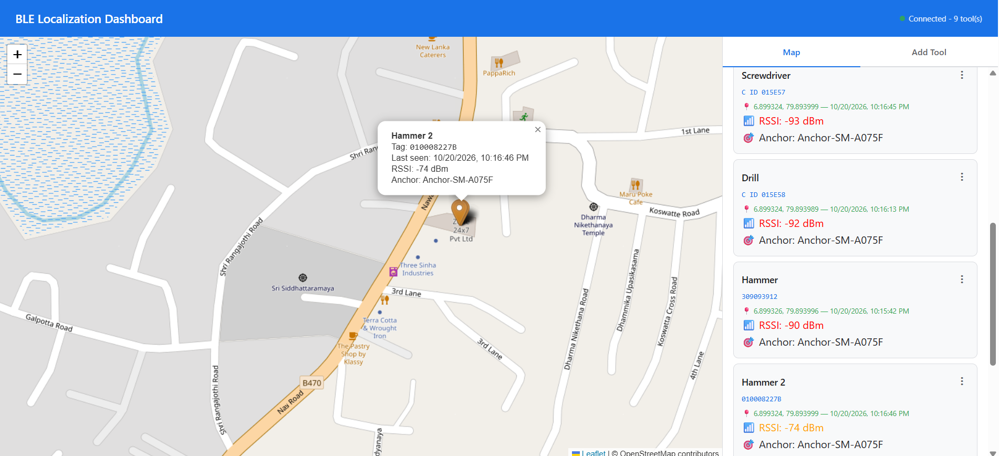

# HILTI BLE — Android Anchor App

An Android app that turns a phone into a **BLE anchor**: it scans continuously in the background for BLE tags fitted to tools, works out the phone's GPS position, and uploads each sighting (location, RSSI, anchor identity) to **Firebase Realtime Database**. The **BLE Localization Dashboard** ([../ble-localization-poc](../ble-localization-poc/README.md)) reads the same data and shows it on a live map.

The app also lets field users create tools, map tags by **BLE scan** or **camera barcode scan**, and view tools on an OpenStreetMap map.

---

## Table of Contents

- [Screenshots](#screenshots)
- [Features](#features)
- [Tech Stack](#tech-stack)
- [Project Structure](#project-structure)
- [Setup & Build](#setup--build)
- [Permissions](#permissions)
- [App Lifecycle](#app-lifecycle)
- [BLE Scanning](#ble-scanning)
- [Packet Parsers](#packet-parsers)
- [Batch Processing & Location](#batch-processing--location)
- [Firebase Writes](#firebase-writes)
- [Tag ID Encoding](#tag-id-encoding)
- [Screens & User Flows](#screens--user-flows)
- [Anchor Selection](#anchor-selection)
- [Architecture: DI, Data & ViewModels](#architecture-di-data--viewmodels)
- [Background Reliability](#background-reliability)
- [Testing](#testing)
- [Adding a New Tag Type](#adding-a-new-tag-type)
- [Troubleshooting](#troubleshooting)

---

## Screenshots

> Add phone screenshots to `docs/screenshots/` using the file names below and they will appear here.

| Map | Tools List | Tag Mapping (BLE Scan) |
|:---:|:---:|:---:|
|  |  |  |
| All tools on OpenStreetMap | Service status, tools, Map Tag / Unmap / Locate | 10 s scan of nearby tags |

| Barcode Scan | Add Tool | Foreground Notification |
|:---:|:---:|:---:|
|  |  |  |
| Camera + ML Kit, 5-read consensus | Create a tool by name | "BLE Tracking Active" |

The same data in the web dashboard:



---

## Features

- **Always-on BLE scanning** in a foreground service, including with the screen off.
- **Multi-vendor tags**: Hilti ON!Track, ELA Blue Coin, EM Microelectronic, Milwaukee.
- **5-second batching** of detections → one Firebase update per mapped tag per batch.
- **Adaptive GPS** — location runs only while mapped tags are nearby.
- **Tag mapping** by BLE scan or camera barcode / Data Matrix scan.
- **Duplicate protection** — a tag can only be mapped to one tool.
- **Unmapped-tag notifications** (throttled to once per 30 s per tag).
- **Anchor identity** — per-install UUID + friendly name (`Anchor-<model>`).
- **Strongest-anchor selection** for the in-app list and map.
- **Survives** reboots, app swipes, Doze and OS kills.

---

## Tech Stack

| Area | Library / Tool | Version |
|---|---|---|
| Language | Kotlin | 2.0.0 |
| Build | Gradle Kotlin DSL + version catalog (`gradle/libs.versions.toml`) | AGP 8.13.2 |
| SDK | `compileSdk` 36 · `targetSdk` 36 · `minSdk` 24 · Java 11 | — |
| UI | Jetpack Compose, Material 3, Material Icons Extended | Compose BOM 2024.09.00 |
| DI | Hilt (KSP), `hilt-navigation-compose`, `hilt-work` (kapt) | 2.51.1 / 1.2.0 |
| Async | Kotlin Coroutines, `Flow`, `StateFlow`, `callbackFlow` | 1.8.0 |
| Lifecycle | `lifecycle-service`, `viewmodel-compose`, `runtime-compose` | 2.8.0 |
| Background | Foreground service, `PARTIAL_WAKE_LOCK`, WorkManager | 2.9.0 |
| BLE | `BluetoothLeScanner`, `ScanFilter`, `SCAN_MODE_LOW_LATENCY` | platform |
| Location | Play Services `FusedLocationProviderClient` | 21.3.0 |
| Map | osmdroid (OpenStreetMap) + `preference-ktx` | 6.1.18 |
| Camera | CameraX (`camera2`, `lifecycle`, `view`) | 1.3.4 |
| Barcode | ML Kit Barcode Scanning | 17.2.0 |
| Backend | Firebase Realtime Database (KTX) + Analytics | Firebase BOM 33.1.2 |
| Tests | JUnit 4, AndroidX JUnit, Espresso, Compose UI Test | 4.13.2 / 1.3.0 / 3.7.0 |

---

## Project Structure

```
HILTIBLE/
├── app/
│   ├── build.gradle.kts
│   ├── google-services.json                 # Firebase Android config
│   └── src/
│       ├── main/
│       │   ├── AndroidManifest.xml          # Permissions, service, boot receiver
│       │   └── java/com/example/hiltible/
│       │       ├── HiltiBleApplication.kt   # @HiltAndroidApp, WorkManager + HiltWorkerFactory
│       │       ├── MainActivity.kt          # Permissions, battery exemption, screen navigation
│       │       ├── BootReceiver.kt          # Restart service on boot / app update
│       │       ├── ble/
│       │       │   ├── BleTagDetector.kt    # Scanner, batch processor, location, Firebase writer
│       │       │   ├── HiltiPacketParser.kt
│       │       │   ├── ElaPacketParser.kt
│       │       │   ├── EmPacketParser.kt
│       │       │   ├── MilwaukeePacketParser.kt
│       │       │   └── anchor/              # AnchorSelector, AnchorInfo, AnchorSelectionState, AnchorSelectionRepository
│       │       ├── dashboard/               # DashboardAnchorSelector, AnchorSelectionCache
│       │       ├── data/
│       │       │   ├── entity/Tool.kt
│       │       │   └── repository/ToolRepository.kt
│       │       ├── di/DatabaseModule.kt     # Firebase refs, location client, detector, selectors
│       │       ├── service/BleTrackingService.kt
│       │       ├── ui/
│       │       │   ├── screen/              # MapScreen, ToolsListScreen, TagMappingScreen, BarcodeScanScreen
│       │       │   ├── viewmodel/           # ToolsListViewModel, TagMappingViewModel
│       │       │   └── theme/
│       │       └── work/LocationUpdateWorker.kt
│       ├── test/                            # Unit tests (anchor selection, cache)
│       └── androidTest/
├── gradle/libs.versions.toml
├── build.gradle.kts · settings.gradle.kts   # rootProject.name = "HILTI BLE"
├── DASHBOARD_ANCHOR_SELECTION_GUIDE.md
└── QUICK_REFERENCE.md
```

---

## Setup & Build

### Requirements

- Android Studio (recent stable, supporting AGP 8.13) with JDK 11+
- A physical Android device with BLE (emulators can't scan BLE), API 24+
- A Firebase project with Realtime Database

### Firebase

1. In Firebase Console, add an Android app with package **`com.example.hiltible`**.
2. Download **`google-services.json`** into `HILTIBLE/app/` (replace the existing one to use your own project).
3. The app reads and writes `ble-localization-poc/tools` and `ble-localization-poc/sightings` — the dashboard must use the same database.

### Build & install

```bash
cd HILTIBLE
./gradlew assembleDebug       # build APK → app/build/outputs/apk/debug/
./gradlew installDebug        # install on a connected device
./gradlew test                # unit tests
```

On Windows use `gradlew.bat`. Or open `HILTIBLE/` in Android Studio and press **Run**.

### First launch

1. Grant **Nearby devices** (Bluetooth), **Location**, **Camera** and **Notifications**.
2. When prompted, set Location to **"Allow all the time"** (needed for screen-off scanning).
3. Accept **Ignore battery optimisations**.
4. The service starts and shows a persistent **"BLE Tracking Active"** notification.

---

## Permissions

| Permission | Why |
|---|---|
| `BLUETOOTH_SCAN`, `BLUETOOTH_CONNECT` (API 31+) / `BLUETOOTH`, `BLUETOOTH_ADMIN` (≤ 30) | Scan for tags, read device names |
| `ACCESS_FINE_LOCATION`, `ACCESS_COARSE_LOCATION` | GPS coordinates; required for BLE scanning |
| `ACCESS_BACKGROUND_LOCATION` | Keep working with screen off / app in background (requested separately) |
| `CAMERA` | Barcode scanning |
| `POST_NOTIFICATIONS` (API 33+) | Foreground-service and unmapped-tag notifications |
| `FOREGROUND_SERVICE`, `FOREGROUND_SERVICE_CONNECTED_DEVICE`, `FOREGROUND_SERVICE_LOCATION` | Foreground service types (Android 14+) |
| `WAKE_LOCK` | Keep CPU awake while screen is off |
| `RECEIVE_BOOT_COMPLETED` | Auto-start after reboot |
| `REQUEST_IGNORE_BATTERY_OPTIMIZATIONS` | Avoid Doze pausing the service |
| `INTERNET`, `ACCESS_NETWORK_STATE` | Firebase and map tiles |

---

## App Lifecycle

```
Device boot / app launch
  └─ HiltiBleApplication.onCreate()       Hilt + WorkManager(HiltWorkerFactory)
  └─ MainActivity.onCreate()               request permissions → background location → battery exemption
  └─ BleTrackingService.onStartCommand()
       ├─ start foreground notification
       ├─ bleTagDetector.refreshTagCache()   load tagUuid → toolId mappings
       ├─ bleTagDetector.startScanning()
       ├─ restart BLE scan every 60 s
       ├─ refresh WakeLock every 8 min (10-min timeout)
       └─ acquire PARTIAL_WAKE_LOCK
```

`BootReceiver` handles `BOOT_COMPLETED` and `MY_PACKAGE_REPLACED`. The service returns `START_STICKY`, restarts itself in `onTaskRemoved()`, and `MainActivity.onResume()` calls `ensureServiceRunning()`.

---

## BLE Scanning

- **Manufacturer filters** for IDs 780, 1879, 90, 357 and 67 — Android 8.1+ stops *unfiltered* scans when the screen is off; filtered scans are matched in the Bluetooth controller and keep running.
- **`SCAN_MODE_LOW_LATENCY`** with `setReportDelay(0)` for immediate callbacks.
- Each callback records the tag ID, its type, the latest RSSI and the detection time (ms) in thread-safe `ConcurrentHashMap`s.

```
onScanResult()
 ├─ MFC 780  → HiltiPacketParser      → type "hilti"
 ├─ MFC 1879 → ElaPacketParser        → type "ela"
 ├─ MFC 357  → MilwaukeePacketParser  → type "milwaukee"
 ├─ MFC 90   → EmPacketParser         → type "em"
 └─ MFC 67   → Hilti parser (test)
```

---

## Packet Parsers

| Parser | MFC ID | Rule | Output |
|---|---|---|---|
| `HiltiPacketParser` | 780 (`0x030C`) | ≥ 8 bytes; bytes 2–7 | 12-char lowercase hex, e.g. `d32218666c12` |
| `ElaPacketParser` | 1879 (`0x0757`) | DataInfo byte `0x06`; ID from Complete Local Name | `C ID 015E58` (accepts `015E58`, `CID015E58`, `cid015e58`) |
| `EmPacketParser` | 90 (`0x005A`) | AltBeacon signature `0xBE 0xAC`; ID from device MAC | 12-char uppercase hex, e.g. `58C35608EEB0` |
| `MilwaukeePacketParser` | 357 (`0x0165`) | ≥ 5 bytes; bytes 0–4 | 10-char uppercase hex, e.g. `010008227B` |

---

## Batch Processing & Location

Every **5 s** (`BATCH_INTERVAL_MS`), `BleTagDetector`:

1. Snapshots and clears `pendingTags`.
2. Reads the cached GPS fix.
3. For each tag: looks it up in the `mappedTags` cache → if mapped, writes the tool update and a sighting; if unknown, queries Firebase, and if still unmapped shows a throttled notification.
4. Starts or stops GPS:

| State | Rule |
|---|---|
| Start GPS | A mapped tag appears in a batch |
| Poll | Every 5 s via `getCurrentLocation(HIGH_ACCURACY)` |
| Stop GPS | 2 consecutive batches with no mapped tags (~10 s) |

The `mappedTags` cache is kept fresh by a Firebase `ValueEventListener` on `tools/` plus explicit `refreshTagCache()` calls after mapping changes — so mappings made in the dashboard reach the phone automatically.

---

## Firebase Writes

For every mapped tag with a valid location, two writes:

```jsonc
// A. overwrite current state
ble-localization-poc/tools/{toolId}: {
  lastLat, lastLng, lastSeenAt, lastRssi, lastAnchorId, lastAnchorName
}

// B. append history (used by dashboard winner selection)
ble-localization-poc/sightings/{pushId}: {
  tagUuid, anchorLat, anchorLng, timestamp, rssi, anchorId, anchorName
}
```

**Anchor identity** is stored in `SharedPreferences` (`BleTagDetectorPrefs`): `anchorId` (UUID, generated once) and `anchorName` (default `Anchor-${Build.MODEL}`, e.g. `Anchor-SM-A075F`; changeable via `setAnchorName()`).

---

## Tag ID Encoding

Hilti barcodes are decimal, while the BLE payload is little-endian hex:

| Step | Value |
|---|---|
| Barcode | `309257752` |
| → hex (pad 8) | `126c6618` |
| → reverse bytes | `18666c12` |
| → add `d322` | **`d32218666c12`** (stored) |

```kotlin
fun encodeBarcodeToTagUuid(decimal: String): String {
    val hex = decimal.toLong().toString(16).padStart(8, '0')
    return "d322" + hex.chunked(2).reversed().joinToString("")
}
```

| Type | Barcode / label | Stored | Shown in app |
|---|---|---|---|
| Hilti | `309257752` | `d32218666c12` | `309257752` |
| ELA | `CID015E58` | `C ID 015E58` | `C ID 015E58` |
| EM | `194536388608856` | `58C35608EEB0` | decimal serial |
| Milwaukee | `010008227B` | `010008227B` | raw hex |

The dashboard uses identical conversions.

---

## Screens & User Flows

Bottom navigation switches between **Map** and **Tools**; other screens open from there.

```
Map ◀──────────── Bottom nav ────────────▶ Tools
                                             ├─ + Add Tool (dialog)
                                             ├─ Map Tag ─▶ TagMappingScreen
                                             │               ├─ BLE Scan (10 s)
                                             │               └─ Camera Scan ─▶ BarcodeScanScreen
                                             ├─ Unmap
                                             ├─ Locate ─▶ Map, focused on the tool
                                             └─ Delete (confirm)
```

| Screen | What it does |
|---|---|
| **MapScreen** | osmdroid map with a marker per located tool; tapping a marker opens a details card (name, tag, coordinates, last seen, selected anchor); zoom-in/out buttons; refresh FAB clears all last-seen data. |
| **ToolsListScreen** | Service-status card, tool cards (name, formatted tag or *No tag mapped*, last seen, anchor + RSSI, online dot), actions Map Tag / Unmap / Locate / Delete, FAB to add a tool. |
| **TagMappingScreen** | **BLE Scan**: 10 s session, polls detected tags each second, lists type, ID, RSSI and whether already mapped; tap to assign. **Camera Scan**: opens barcode scanner. |
| **BarcodeScanScreen** | CameraX preview + ML Kit; viewfinder with crosshair, centre-most barcode only, ISO-8859-1 fallback, digits extraction, **5 identical reads** to accept, beep + haptic feedback, duplicate check. |

---

## Anchor Selection

Two layers, independent of the dashboard's own 1-second winner selection:

| Component | Where | Logic | Defaults |
|---|---|---|---|
| `AnchorSelector` | `ble/anchor/` | Per-tag RSSI history, average RSSI, hysteresis + consecutive-reading challenger to prevent flapping, offline detection | 10 s active window, 5 dBm hysteresis, 3 readings, 10 history |
| `DashboardAnchorSelector` + `AnchorSelectionCache` | `dashboard/` | Among tool records sharing a tag, pick strongest active anchor; cache result | 60 s active window, 30 s cache |

`ToolsListViewModel.tools` uses `ToolRepository.getToolsWithDashboardSelectionFlow()`, which fills `selectedAnchorId`, `selectedAnchorName`, `lastRssi` and `isOnline` on each `Tool`. See [DASHBOARD_ANCHOR_SELECTION_GUIDE.md](DASHBOARD_ANCHOR_SELECTION_GUIDE.md) and [QUICK_REFERENCE.md](QUICK_REFERENCE.md).

---

## Architecture: DI, Data & ViewModels

**Hilt — `di/DatabaseModule.kt`** (all `@Singleton`):

| Provider | Provides |
|---|---|
| `provideFirebaseDatabase()` | `FirebaseDatabase` |
| `provideToolsReference()` | `ble-localization-poc/tools` |
| `provideSightingsReference()` | `ble-localization-poc/sightings` |
| `provideFusedLocationClient()` | `FusedLocationProviderClient` |
| `provideAnchorSelector()` / `provideAnchorSelectionRepository()` | Anchor selection |
| `provideBleTagDetector()` | The single shared scanner used by service and UI |

Entry points: `@HiltAndroidApp HiltiBleApplication`, `@AndroidEntryPoint MainActivity` / `BleTrackingService`, `@HiltViewModel` view models, `@HiltWorker LocationUpdateWorker`.

**`Tool` entity** — `id`, `name`, `tagUuid`, `lastLat`, `lastLng`, `lastSeenAt`, `lastAnchorId`, `lastAnchorName`, `lastRssi`, `selectedAnchorId`, `selectedAnchorName`, `isOnline`, `anchorCandidates`.

**`ToolRepository`**

| Method | Purpose |
|---|---|
| `getAllToolsFlow()` | Real-time `Flow<List<Tool>>` (`callbackFlow`) |
| `getToolsWithDashboardSelectionFlow()` | Same, with strongest-anchor selection applied |
| `getToolById()`, `getToolByTagUuid()` | One-shot lookups |
| `insertTool()`, `updateTool()`, `deleteTool()` | CRUD |
| `unmapTag()` | Set `tagUuid = null` |
| `clearAllLastSeen()` | Reset all locations |
| `invalidateSelectionCache()`, `getSelectionCacheStats()` | Selection cache control |

**ViewModels**
- `ToolsListViewModel` — `tools: StateFlow`, `addToolWithName()`, `deleteTool()`, `unmapTag()` (refreshes BLE cache), `clearAllLastSeen()`.
- `TagMappingViewModel` — scan state `IDLE → SCANNING → DONE`, session-tag polling, enrichment with mapped tool names, barcode → storage conversion, duplicate checks, cache refresh.

---

## Background Reliability

| Strategy | Purpose |
|---|---|
| Foreground service (`connectedDevice|location`) | OS won't kill the process |
| `PARTIAL_WAKE_LOCK`, refreshed every 8 min | CPU stays awake with screen off |
| BLE scan restart every 60 s | Recover from Android silently stopping long scans |
| Manufacturer `ScanFilter`s | Screen-off scanning on Android 8.1+ |
| `START_STICKY` | Restart after memory kills |
| `onTaskRemoved()` | Restart after the user swipes the app away |
| `BootReceiver` | Start after reboot / update |
| Battery-optimisation exemption | Avoid Doze suspension |
| `ensureServiceRunning()` on resume | Restart if stopped |

> Some OEMs (Samsung, Xiaomi, Huawei…) add their own battery killers. Also set the app to **Unrestricted** battery usage in system settings.

---

## Testing

```bash
./gradlew test
./gradlew test --tests "com.example.hiltible.dashboard.DashboardAnchorSelectorTest"
./gradlew test --tests "com.example.hiltible.dashboard.AnchorSelectionCacheTest"
./gradlew test --tests "com.example.hiltible.ble.anchor.AnchorSelectorTest"
./gradlew connectedAndroidTest   # instrumented, needs a device
```

Unit tests cover strongest-anchor choice, re-evaluation after cache expiry, offline anchors, tie handling, batch selection, and cache hit / miss / expiry / invalidation.

**Field test:** run the app on 2+ phones near the same tag and confirm the dashboard shows the strongest anchor; stop one phone and confirm failover.

---

## Adding a New Tag Type

1. Create `ble/AcmePacketParser.kt`:
   ```kotlin
   object AcmePacketParser {
       const val MANUFACTURER_ID = 999
       fun parse(data: ByteArray): AcmePacket? { /* extract ID or return null */ }
   }
   data class AcmePacket(val tagUuid: String)
   ```
2. Add `ScanFilter.Builder().setManufacturerData(AcmePacketParser.MANUFACTURER_ID, byteArrayOf()).build()` to the filter list in `BleTagDetector.startScanning()`.
3. Add a branch in `scanCallback.onScanResult()` that sets `pendingTags`, `tagTypes[id] = "acme"`, `tagRssiMap`, `tagDetectionTimes`.
4. Add display / barcode conversion in `TagMappingViewModel` and `ToolsListScreen`.
5. Add the type to the dashboard (see [../ble-localization-poc/README.md](../ble-localization-poc/README.md#adding-a-new-tag-type)).

---

## Troubleshooting

| Symptom | Check |
|---|---|
| No tags detected | Bluetooth on; Location on; permissions granted; tag's MFC ID is one of the filters |
| Stops when screen is off | Location = "Allow all the time"; battery = Unrestricted; notification visible |
| Tag seen but location not updating | Tag mapped to a tool? GPS fix available? (no fix → write skipped) |
| "Tag X is not mapped to any tool" | Map it from Tools → Map Tag or from the dashboard |
| "Tag already mapped to …" | Unmap it from the other tool first |
| Barcode won't read | Hold steady, centre the code, improve light — 5 matching reads are required |
| Data not reaching Firebase | Correct `google-services.json`; database rules; network |

Filter Logcat by `BleTagDetector`, `BleTrackingService`, `HiltiPacketParser`, `MilwaukeePacketParser`, `AnchorSelector`, `DashboardAnchorSelector`, `AnchorSelectionCache`.

---

Full reference: [../docs/android-app-documentation.html](../docs/android-app-documentation.html) · System overview: [../README.md](../README.md)
