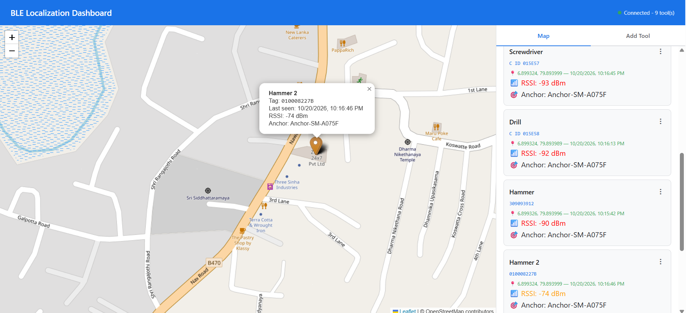

# SFI BLE Localization — BLE Tool Tracking System

Track physical tools (drills, hammers, grinders, any equipment) on job sites using **Bluetooth Low Energy (BLE) tags**, **Android phones acting as anchors**, and a **real-time web dashboard**.

Each tool carries a small battery-powered BLE tag that broadcasts a unique ID. Android phones running the **HILTI BLE** app pick up those broadcasts, stamp them with the phone's GPS position and signal strength (RSSI), and push them to **Firebase Realtime Database**. The **BLE Localization Dashboard** shows every tool on a live map and lets you manage tools and tag mappings.



---

## Table of Contents

- [How It Works](#how-it-works)
- [Repository Structure](#repository-structure)
- [Tech Stack](#tech-stack)
- [Supported BLE Tag Types](#supported-ble-tag-types)
- [Firebase Data Model](#firebase-data-model)
- [Multi-Anchor Winner Selection](#multi-anchor-winner-selection)
- [Getting Started](#getting-started)
- [Tag Mapping Workflows](#tag-mapping-workflows)
- [Adding a New Tag Type](#adding-a-new-tag-type)
- [Performance & Timing](#performance--timing)
- [Security Notes](#security-notes)
- [Documentation](#documentation)
- [Glossary](#glossary)

---

## How It Works

```
┌──────────────┐   BLE advertisements   ┌──────────────────────────┐
│  BLE Tag     │ ─────────────────────▶ │  Android App (Anchor)    │
│  (on a tool) │   every ~1 s, 10–30 m  │  1. Filter by MFC ID     │
└──────────────┘                        │  2. Parse tag ID         │
                                        │  3. Batch every 5 s      │
┌──────────────┐                        │  4. Attach GPS + RSSI    │
│  BLE Tag     │ ─────────────────────▶ │  5. Write to Firebase    │
└──────────────┘                        └────────────┬─────────────┘
                                                     │ HTTPS (Firebase SDK)
                                                     ▼
                                        ┌──────────────────────────┐
                                        │ Firebase Realtime DB     │
                                        │  ble-localization-poc/   │
                                        │   ├─ tools/              │
                                        │   └─ sightings/          │
                                        └────────────┬─────────────┘
                                                     │ WebSocket (live push)
                                                     ▼
                                        ┌──────────────────────────┐
                                        │ Web Dashboard (Leaflet)  │
                                        │  winner selection,       │
                                        │  filters, tool mgmt      │
                                        └──────────────────────────┘
```

- **Anchor** — any Android phone running the app. Deploy several across a site; each reports independently. No phone-to-phone communication is needed.
- **Tool** — a record in Firebase with a name and (optionally) a mapped BLE tag ID.
- **Sighting** — an append-only log entry: *this tag was seen by this anchor, at this location, with this RSSI, at this time.*
- The dashboard resolves multiple anchors seeing the same tag by picking the **strongest RSSI within a 1-second window** (the closest phone).

End-to-end, a tag broadcast typically reaches the dashboard in **~1–6 seconds**.

---

## Repository Structure

```
sfi-ble-localization/
├── HILTIBLE/                     # Android app (Kotlin + Jetpack Compose) — the "anchor"
│   ├── app/src/main/java/com/example/hiltible/
│   │   ├── ble/                  # Scanner + packet parsers (Hilti, ELA, EM, Milwaukee)
│   │   │   └── anchor/           # On-device anchor selection (RSSI averaging, hysteresis)
│   │   ├── dashboard/            # In-app strongest-anchor selection + 30 s cache
│   │   ├── data/                 # Tool entity + Firebase repository
│   │   ├── di/                   # Hilt modules
│   │   ├── service/              # Foreground BLE tracking service
│   │   ├── ui/                   # Compose screens + ViewModels
│   │   └── work/                 # WorkManager location worker
│   ├── DASHBOARD_ANCHOR_SELECTION_GUIDE.md
│   ├── QUICK_REFERENCE.md
│   └── README.md                 # ← Android app README
│
├── ble-localization-poc/         # Web dashboard (vanilla JS + Leaflet + Firebase Hosting)
│   ├── public/
│   │   ├── index.html            # Layout + styles
│   │   ├── app.js                # All dashboard logic
│   │   └── env.example.js        # Firebase config template → copy to env.js
│   ├── firebase.json             # Hosting config (SPA rewrite)
│   ├── .firebaserc               # Firebase project alias
│   └── README.md                 # ← Dashboard README
│
└── docs/                         # Full HTML documentation
    ├── android-app-documentation.html
    ├── dashboard-documentation.html
    ├── system-integration-documentation.html
    └── screenshots/
```

| Component | README |
|---|---|
| Android app (anchor) | [HILTIBLE/README.md](HILTIBLE/README.md) |
| Web dashboard | [ble-localization-poc/README.md](ble-localization-poc/README.md) |

---

## Tech Stack

### Android App — `HILTIBLE/`

| Area | Technology | Version |
|---|---|---|
| Language | Kotlin | 2.0.0 |
| Build | Gradle (Kotlin DSL), Android Gradle Plugin, version catalog | AGP 8.13.2 |
| SDK | compileSdk / targetSdk 36, minSdk 24, Java 11 | — |
| UI | Jetpack Compose + Material 3 (+ extended icons) | Compose BOM 2024.09.00 |
| Dependency injection | Hilt (Dagger) + KSP, Hilt-Work | 2.51.1 |
| Async | Kotlin Coroutines, Flow / StateFlow | 1.8.0 |
| BLE | Android `BluetoothLeScanner` with manufacturer `ScanFilter`s | platform |
| Background | Foreground `LifecycleService`, WakeLock, WorkManager, BootReceiver | WorkManager 2.9.0 |
| Location | Google Play Services FusedLocationProvider | 21.3.0 |
| Maps | osmdroid (OpenStreetMap) | 6.1.18 |
| Camera / barcode | CameraX + Google ML Kit Barcode Scanning | 1.3.4 / 17.2.0 |
| Cloud | Firebase Realtime Database + Analytics | Firebase BOM 33.1.2 |
| Testing | JUnit 4, AndroidX Test, Espresso, Compose UI test | — |

### Web Dashboard — `ble-localization-poc/`

| Area | Technology | Version |
|---|---|---|
| Language | Vanilla JavaScript (ES modules), HTML5, CSS3 (Grid) | — |
| Build | None — no bundler, no framework | — |
| Database | Firebase JS SDK (modular) — Realtime Database | 10.12.2 (gstatic CDN) |
| Map | Leaflet.js + OpenStreetMap tiles | 1.9.4 (unpkg CDN) |
| Markers | Leaflet default + `leaflet-color-markers` (orange / red) | — |
| Hosting | Firebase Hosting (SPA rewrite to `index.html`) | — |

### Shared Backend

| Service | Purpose |
|---|---|
| Firebase Realtime Database | Single source of truth for `tools/` and `sightings/`; real-time sync to app and dashboard |
| Firebase Hosting | Serves the dashboard over HTTPS |
| Firebase project | `eelnd-d4121` (see `.firebaserc` / `google-services.json`) |

---

## Supported BLE Tag Types

The app only listens for advertisements matching these **manufacturer IDs**. Filters are required so scanning keeps working with the screen off (Android 8.1+).

| Tag family | Manufacturer ID | ID source | Stored in Firebase | Shown to users | Dashboard input |
|---|---|---|---|---|---|
| **Hilti ON!Track** | 780 (`0x030C`) | Bytes 2–7 of manufacturer data | `d322` + little-endian hex, e.g. `d32218666c12` | Decimal barcode, e.g. `309257752` | 9 digits |
| **ELA Blue Coin** | 1879 (`0x0757`) | Device local name (DataInfo byte `0x06`) | `C ID 015E58` | `C ID 015E58` | `CID` + 6 hex |
| **EM Microelectronic** | 90 (`0x005A`) | Link-layer MAC (AltBeacon `0xBEAC`) | 12-char hex MAC, e.g. `58C35608EEB0` | Decimal serial, e.g. `194536388608856` | 15 digits |
| **Milwaukee** | 357 (`0x0165`) | First 5 bytes of manufacturer data | 10-char uppercase hex, e.g. `010008227B` | Raw hex (same) | 10 hex |
| Test | 67 | Parsed with the Hilti parser | — | — | development only |

**Hilti encoding example** (barcode → storage):
`309257752` → hex `126c6618` → reverse bytes `18666c12` → prefix `d322` → **`d32218666c12`**.
Decoding runs the same steps in reverse. Both the app and the dashboard implement identical conversions.

---

## Firebase Data Model

All data lives under `ble-localization-poc/` in Realtime Database.

```jsonc
ble-localization-poc/
  tools/
    {pushId}/
      name:           "Hammer 2"
      tagUuid:        "010008227B"      // null = no tag mapped
      tagType:        "milwaukee"       // "hilti" | "ela" | "em" | "milwaukee"
      lastLat:        6.899324          // 0 = never seen
      lastLng:        79.893999
      lastSeenAt:     1792512406000     // Unix ms
      lastRssi:       -74               // dBm
      lastAnchorId:   "550e8400-..."    // UUID of reporting phone
      lastAnchorName: "Anchor-SM-A075F"

  sightings/
    {pushId}/                           // append-only history
      tagUuid:    "010008227B"
      anchorLat:  6.899324
      anchorLng:  79.893999
      timestamp:  1792512406000
      rssi:       -74
      anchorId:   "550e8400-..."
      anchorName: "Anchor-SM-A075F"
```

- **`tools`** holds the *current* state, overwritten on every detection.
- **`sightings`** is the history used for multi-anchor winner selection.
- Anchor identity is a UUID generated on first launch and stored in `SharedPreferences`; the default name is `Anchor-<Build.MODEL>`.

---

## Multi-Anchor Winner Selection

When several phones see the same tag, the dashboard (`computeWinners()` in `app.js`):

1. Takes all sightings for the tool's `tagUuid`, newest first.
2. Keeps those within **1000 ms** of the newest sighting.
3. Picks the one with the **highest RSSI** (closest phone).
4. Stores it on `tool.computed` and uses it for the marker and card.

| RSSI | Approx. distance | Position quality |
|---|---|---|
| −30 to −50 dBm | < 1 m | Excellent |
| −50 to −70 dBm | 1–5 m | Good |
| −70 to −85 dBm | 5–15 m | Fair |
| −85 to −100 dBm | 15 m + | Poor |

The Android app has two extra selection layers: `ble/anchor/AnchorSelector` (RSSI averaging, 5 dBm hysteresis, 3-reading challenger threshold, 10 s active window) and `dashboard/DashboardAnchorSelector` (strongest active anchor within 60 s, cached for 30 s), which drives the in-app Tools list and map. See [HILTIBLE/DASHBOARD_ANCHOR_SELECTION_GUIDE.md](HILTIBLE/DASHBOARD_ANCHOR_SELECTION_GUIDE.md).

---

## Getting Started

### Prerequisites

- A Firebase project with **Realtime Database** and **Hosting** enabled
- **Android Studio** (recent stable, AGP 8.13 support) with JDK 11+
- An Android phone with BLE (Android 7.0 / API 24+); Android 12+ recommended
- **Node.js** + **Firebase CLI** (`npm i -g firebase-tools`) for the dashboard
- At least one supported BLE tag

### 1. Configure Firebase

1. Create (or reuse) a Firebase project and enable Realtime Database.
2. Register an Android app with package `com.example.hiltible` and download `google-services.json` into `HILTIBLE/app/`.
3. Register a Web app and note its config values.

### 2. Run the Android app

```bash
cd HILTIBLE
./gradlew installDebug        # or open in Android Studio and Run
```

Grant Bluetooth, Location (**"Allow all the time"**), Camera and Notifications, and accept the battery-optimisation exemption. Details: [HILTIBLE/README.md](HILTIBLE/README.md).

### 3. Run / deploy the dashboard

```bash
cd ble-localization-poc
cp public/env.example.js public/env.js   # fill in your Web app config
npx serve public                         # local preview (any static server works)
firebase deploy --only hosting           # deploy
```

Details: [ble-localization-poc/README.md](ble-localization-poc/README.md).

---

## Tag Mapping Workflows

A tag must be **mapped** to a tool before its location is tracked.

| Where | How |
|---|---|
| **Android app** | Create a tool by name → **Map Tag** → either **BLE Scan** (10 s scan lists nearby tags with type, ID, RSSI and mapped status) or **Camera Scan** (barcode/Data Matrix via ML Kit, 5-read consensus). |
| **Dashboard** | **Add Tool** tab → name + tag type + tag ID in the segmented input → creates the tool *and* maps the tag in one step. |

Both sides block duplicate mappings (application-level; Firebase has no unique constraint). Unmapping sets `tagUuid` to `null`; the app's tag cache updates automatically via a Firebase listener.

---

## Adding a New Tag Type

**Android app**
1. Add `ble/<Vendor>PacketParser.kt` with `MANUFACTURER_ID` and `parse()`.
2. Add a `ScanFilter` for the ID in `BleTagDetector.startScanning()`.
3. Add a branch in `scanCallback.onScanResult()` that fills `pendingTags`, `tagTypes`, `tagRssiMap`, `tagDetectionTimes`.
4. Add display/barcode conversion in `TagMappingViewModel` and `ToolsListScreen`.

**Dashboard**
1. Add an `<option>` to the tag type `<select>` in `index.html`.
2. Add an entry to `TAG_INPUT_CONFIG` in `app.js`.
3. Add branches to `formatTagForDisplay()`, `formatTagForStorage()` and `inferTagType()`.

---

## Performance & Timing

| Stage | Typical latency |
|---|---|
| Tag broadcast → app callback | < 100 ms |
| Batch window | 0–5 s |
| Firebase write | 50–200 ms |
| Firebase → dashboard listener | < 100 ms |
| **Total** | **~1–6 s** |

Key optimisations: in-memory `tagUuid → toolId` cache, 5-second batching, adaptive GPS (stops after ~10 s with no mapped tags), unmapped-tag notification throttle (30 s), 300 ms debounced map-bounds filtering.

---

## Security Notes

- Firebase API keys in `google-services.json` / `env.js` identify the project; they are **not** secrets. Access control is done by **Firebase Security Rules**.
- The database currently uses **open read/write rules** for development. **Lock them down (require Auth) before production.**
- `public/env.js` is described as gitignored but is **not** listed in `ble-localization-poc/.gitignore` — add it if you don't want your config committed.
- The dashboard escapes all user strings (`escapeHtml()`); Compose escapes text on Android.
- Anchor GPS positions and device names are stored. Consider a retention policy for `sightings/`, which grows without bound.

---

## Documentation

Full documentation lives in [`docs/`](docs/) (open in a browser):

| Document | Covers |
|---|---|
| [android-app-documentation.html](docs/android-app-documentation.html) | Lifecycle, BLE scanning, parsers, batching, Firebase, UUID encoding, UI, DI, background strategies |
| [dashboard-documentation.html](docs/dashboard-documentation.html) | Tech stack, listeners, state, winner selection, layout, filters, map, tool management, tag input |
| [system-integration-documentation.html](docs/system-integration-documentation.html) | End-to-end flow, multi-anchor coordination, mapping workflows, consistency, edge cases, security, glossary |
| [HILTIBLE/DASHBOARD_ANCHOR_SELECTION_GUIDE.md](HILTIBLE/DASHBOARD_ANCHOR_SELECTION_GUIDE.md) | In-app strongest-anchor selection and caching |
| [HILTIBLE/QUICK_REFERENCE.md](HILTIBLE/QUICK_REFERENCE.md) | Quick reference for the anchor selection implementation |

> The HTML docs predate the Milwaukee tag type; the code and these READMEs include it.

---

## Glossary

| Term | Meaning |
|---|---|
| **Anchor** | An Android phone running the app and reporting tag sightings |
| **BLE** | Bluetooth Low Energy |
| **RSSI** | Received Signal Strength Indicator (dBm). Closer to 0 = stronger = closer |
| **Manufacturer ID (MFC ID)** | 16-bit Bluetooth SIG company ID at the start of manufacturer-specific advertising data |
| **Scan filter** | Hardware-level BLE match rule; required for screen-off scanning |
| **Sighting** | One logged detection of a tag by an anchor |
| **Winner selection** | Choosing the strongest-RSSI sighting within a 1 s window |
| **Foreground service** | Android service with a persistent notification that the OS won't kill |
| **WakeLock** | Keeps the CPU awake while the screen is off |
