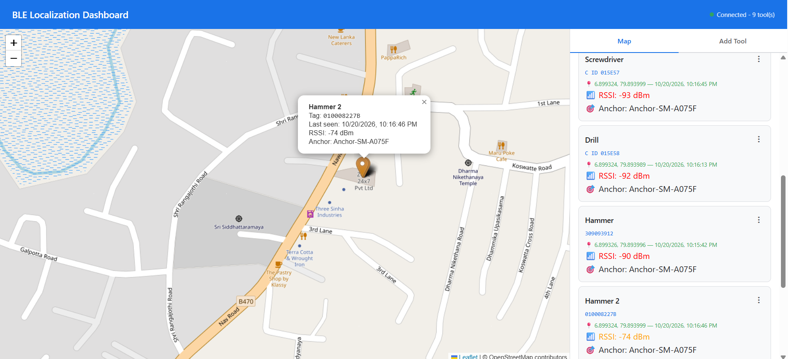

# BLE Localization Dashboard

A real-time, single-page web dashboard that shows the location of BLE-tagged tools on a map, using data reported by the **HILTI BLE** Android anchor app through **Firebase Realtime Database**.

No build step, no framework: one `index.html`, one `app.js`, served by **Firebase Hosting**.



*Map view: the popup shows the selected tool (name, tag ID, last seen, RSSI, reporting anchor). The sidebar lists every tool with coordinates, colour-coded RSSI and anchor name. The header shows connection status and tool count.*

---

## Table of Contents

- [Features](#features)
- [Tech Stack](#tech-stack)
- [Project Structure](#project-structure)
- [Setup](#setup)
- [Run Locally](#run-locally)
- [Deploy](#deploy)
- [How It Works](#how-it-works)
- [UI Guide](#ui-guide)
- [Tag Types & Formats](#tag-types--formats)
- [Firebase Operations](#firebase-operations)
- [Adding a New Tag Type](#adding-a-new-tag-type)
- [Troubleshooting](#troubleshooting)
- [Security](#security)

---

## Features

- **Live map** — tool markers update within milliseconds of a Firebase write (no polling).
- **Multi-anchor winner selection** — when several phones see the same tag, the strongest RSSI within 1 s wins.
- **Tool management** — add a tool with its tag in one step, unmap a tag, delete a tool.
- **Filtering** — by tool name, tag ID, last-seen date range, and current map bounds.
- **Multiple tag families** — Hilti, ELA, EM and Milwaukee, each with its own input format and conversion.
- **Segmented tag input** — OTP-style boxes with auto-advance, paste support and per-type validation.
- **Responsive** — stacks map above sidebar under 900 px width.
- **XSS-safe** — all user strings are escaped before rendering.

---

## Tech Stack

| Technology | Version | Role |
|---|---|---|
| Vanilla JavaScript (ES modules) | — | All logic in `app.js`; no bundler or framework |
| HTML5 + CSS3 (Grid) | — | Layout and styles inline in `index.html` |
| Firebase JS SDK (modular) | 10.12.2 | `firebase-app` + `firebase-database`, loaded from `gstatic.com` |
| Leaflet.js | 1.9.4 | Interactive map, loaded from `unpkg.com` |
| OpenStreetMap tiles | — | Base map imagery |
| leaflet-color-markers | — | Orange (tagged) and red (highlighted) marker icons |
| Firebase Hosting | — | HTTPS static hosting with SPA rewrite |

---

## Project Structure

```
ble-localization-poc/
├── .firebaserc            # Firebase project alias (default: eelnd-d4121)
├── firebase.json          # Hosting: site "ble-localization-poc", public/, rewrite ** → /index.html
├── skills-lock.json       # Agent skill lock (tooling only, not used at runtime)
└── public/
    ├── index.html         # Page layout, styles, tabs, forms; loads env.js, Leaflet, app.js
    ├── app.js             # Firebase listeners, winner selection, filters, map, tool CRUD, tag input
    ├── env.example.js     # Template for Firebase Web config
    └── env.js             # Your Firebase Web config (create from the template)
```

---

## Setup

### Prerequisites

- A Firebase project with **Realtime Database** enabled (the same one the Android app uses)
- **Node.js** and the **Firebase CLI**

```bash
npm install -g firebase-tools
firebase login
```

### Configure Firebase

Copy the template and fill in the values from **Firebase Console → Project settings → Your apps → Web app**:

```bash
cp public/env.example.js public/env.js
```

```js
// public/env.js
window.__FIREBASE_API_KEY__             = '...';
window.__FIREBASE_AUTH_DOMAIN__         = 'your-project.firebaseapp.com';
window.__FIREBASE_DATABASE_URL__        = 'https://your-project-default-rtdb.<region>.firebasedatabase.app';
window.__FIREBASE_PROJECT_ID__          = 'your-project-id';
window.__FIREBASE_STORAGE_BUCKET__      = 'your-project.appspot.com';
window.__FIREBASE_MESSAGING_SENDER_ID__ = '...';
window.__FIREBASE_APP_ID__              = '1:...:web:...';
window.__FIREBASE_MEASUREMENT_ID__      = 'G-...';
```

> `env.js` must be deployed (the browser needs it), but you may not want it in Git. It is **not** currently listed in `.gitignore` — add `public/env.js` there if needed.

To point at a different project, update `.firebaserc` (`firebase use --add`).

---

## Run Locally

ES modules need to be served over HTTP (opening `index.html` from disk won't work):

```bash
# Option 1 — Firebase emulator for hosting
firebase serve --only hosting        # http://localhost:5000

# Option 2 — any static server
npx serve public
```

---

## Deploy

```bash
firebase deploy --only hosting
```

`firebase.json` deploys `public/` to the Hosting site **`ble-localization-poc`** and rewrites every path to `/index.html`.

---

## How It Works

### Data flow

```
Firebase Realtime DB
   ├─ ble-localization-poc/tools      ──onValue──▶ tools[]      ─┐
   └─ ble-localization-poc/sightings  ──onValue──▶ sightings[]  ─┤
                                                                 ▼
                                                     computeWinners()
                                                                 ▼
                                                      applyFilters()
                                                   name → tag → date → bounds
                                                                 ▼
                                              renderTools()  +  updateMap()
```

- Two persistent `onValue` listeners keep `tools` and `sightings` in sync.
- Any change re-runs winner selection, filters, the sidebar and the markers.
- On listener error the status dot turns red and shows the message; Firebase reconnects automatically.

### Winner selection

For each tool with a `tagUuid`:

1. Collect its sightings, newest first.
2. Keep those within `STRONGEST_WINDOW_MS` (**1000 ms**) of the newest.
3. Choose the highest RSSI.
4. Store `{ lat, lng, timestamp, rssi, anchorId, anchorName, windowSize }` on `tool.computed`.

Markers and cards prefer `computed` and fall back to the raw `lastLat` / `lastLng` written by the app.

**Example:** Pixel 6 at −55 dBm (10:00:00.500) and Galaxy S23 at −70 dBm (10:00:00.800) are both within the window → Pixel 6 wins.

### Key state (`app.js`)

| Variable | Purpose |
|---|---|
| `tools` / `filteredTools` | All tools / tools after filters |
| `sightings` | All sighting records |
| `markers` | Leaflet markers keyed by tool ID |
| `highlightedToolId` | Tool currently selected on the map |
| `currentTagType`, `tagSegmentInputs` | Add Tool form state |
| `mapBoundsDebounceTimer` | 300 ms debounce for bounds filtering |

---

## UI Guide

### Layout

| Area | Contents |
|---|---|
| Header | Title + connection status (`Connected - N tool(s)`) |
| Map (left) | Full-height Leaflet map |
| Sidebar (right, 420 px) | **Map** tab (filters + tool cards) and **Add Tool** tab |

### Tool cards

Each card shows the tool name, tag ID in display format (or *No tag mapped*), coordinates and last-seen time, RSSI and the anchor name. The **⋮** menu offers **Unmap Tag** and **Delete**. Clicking a card zooms to the tool (level 18), turns its marker red and opens the popup.

| RSSI colour | Range |
|---|---|
| 🟢 Green | stronger than −60 dBm |
| 🟠 Orange | −60 to −80 dBm |
| 🔴 Red | weaker than −80 dBm |

### Markers

| Colour | Meaning |
|---|---|
| Blue | Tool has no mapped tag |
| Orange | Tool has a mapped tag |
| Red | Currently highlighted tool (drawn on top) |

Click empty map space to clear the highlight. The map deliberately does **not** auto-fit on every update, so live data doesn't keep moving your view.

### Filters

| Filter | Behaviour |
|---|---|
| Tool name | Case-insensitive substring, updates on each keystroke |
| Tag ID | Matches both display format and raw stored value |
| Date range | From / To on `lastSeenAt`; **Include missing** keeps tools never seen |
| Map bounds | Only tools inside the visible map; re-applied 300 ms after pan/zoom |

Each group has a **Reset** button; **Show All Tools** clears everything.

### Add Tool

1. Enter a tool name.
2. Choose the tag type.
3. Type or paste the tag ID into the segmented boxes (auto-advance, Backspace/arrow navigation, invalid characters ignored, hex auto-uppercased).
4. Submit — the ID is converted to storage format, checked for duplicates, and written with `push()` + `set()`.

---

## Tag Types & Formats

| Type | Boxes | Allowed | Example input | Stored as | Conversion |
|---|---|---|---|---|---|
| **Hilti** | 9 | `0-9` | `309257752` | `d32218666c12` | decimal → hex → pad 8 → reverse bytes → `d322` prefix |
| **ELA** | 9 (`C` `I` `D` fixed + 6) | `0-9A-F` | `015E58` | `C ID 015E58` | prefix `C ID ` |
| **EM** | 15 | `0-9` | `194536388608856` | `58C35608EEB0` | decimal → hex → reverse bytes (MAC) |
| **Milwaukee** | 10 | `0-9A-F` | `010008227B` | `010008227B` | uppercase, no conversion |

`inferTagType()` handles tools without a stored `tagType`: starts with `C ID ` → ELA; MAC pattern → EM; 10 hex chars → Milwaukee; otherwise Hilti.

Helpers: `hexToDecimal`, `decimalToHex`, `emMacToDecimal`, `emDecimalToMac`, `normalizeElaTagId`, `formatTagForDisplay`, `formatTagForStorage`. Hilti and EM conversions mirror the Android app exactly.

---

## Firebase Operations

| Action | Method | Path |
|---|---|---|
| Listen to tools | `onValue` | `ble-localization-poc/tools` |
| Listen to sightings | `onValue` | `ble-localization-poc/sightings` |
| Add tool | `push()` + `set()` | `ble-localization-poc/tools/{newId}` |
| Unmap tag | `update({ tagUuid: null })` | `ble-localization-poc/tools/{toolId}` |
| Delete tool | `remove()` | `ble-localization-poc/tools/{toolId}` |

New tool payload:

```json
{ "name": "Hammer Drill", "tagType": "hilti", "tagUuid": "d32218666c12",
  "lastLat": 0, "lastLng": 0, "lastSeenAt": null }
```

The dashboard never writes sightings or locations — those come from the Android anchors.

---

## Adding a New Tag Type

1. `index.html` — add `<option value="acme">Acme</option>` to the tag type select.
2. `app.js` — add `acme: { totalSegments, prefixSegments, inputMode, allowedPattern }` to `TAG_INPUT_CONFIG`.
3. `app.js` — add `acme` branches to `formatTagForDisplay()`, `formatTagForStorage()` and `inferTagType()`.
4. Make sure the Android app produces the same storage format (see [../HILTIBLE/README.md](../HILTIBLE/README.md)).

---

## Troubleshooting

| Symptom | Check |
|---|---|
| Status stays "Connecting…" or shows an error | `env.js` exists and `__FIREBASE_DATABASE_URL__` is correct; database rules allow reads |
| Blank page from `file://` | Serve over HTTP (ES modules) |
| Tool listed but no marker | Location is `0,0` (never seen) or hidden by a filter — try **Show All Tools** |
| "Tag already mapped to …" | That tag is on another tool; unmap it there first |
| "Complete the tag ID boxes first." | Fill every box for the selected type |
| Position jumps between anchors | Expected when anchors report similar RSSI within 1 s |

---

## Security

- The Web API key identifies the project; it isn't a secret. Protect data with **Firebase Security Rules**.
- Current rules are **open read/write** (development). Add Firebase Auth and restrict rules before production.
- `sightings/` grows indefinitely — consider a retention / cleanup job.

---

Full reference: [../docs/dashboard-documentation.html](../docs/dashboard-documentation.html) · System overview: [../README.md](../README.md)
